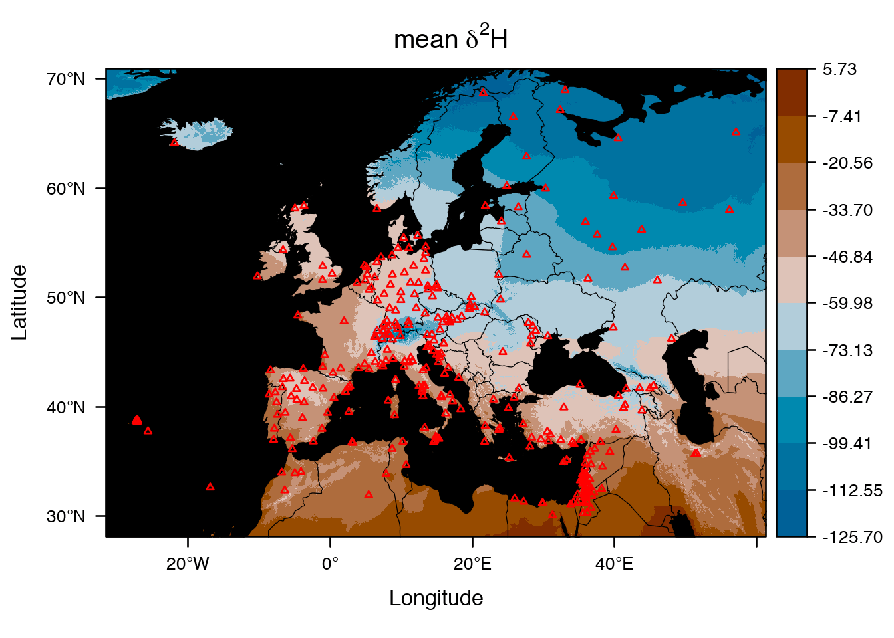

# Welcome to IsoriX
[](https://cran.r-project.org/web/packages/IsoriX)
[](https://www.r-pkg.org/pkg/IsoriX)
[](https://cran.r-project.org/package=IsoriX)


This is the development repository of __IsoriX__, an [R](https://www.r-project.org/) package aiming at building isoscapes using mixed models and inferring the geographic origin of organisms based on their isotopic ratios.




## Where to learn about IsoriX?
You can start by reading our [bookdown](https://courtiol-isorix.share.connect.posit.cloud)!

Then, it may not be a bad idea to also have a look at our papers:
[here](https://www.biorxiv.org/content/10.1101/207662v1) and [there](https://shop.elsevier.com/books/tracking-animal-migration-with-stable-isotopes/hobson/978-0-12-814723-8).

Another great source of help is [our mailing list](https://groups.google.com/g/IsoriX).
First register for free (using your Google account) and then feel free to send us questions.

For specific help on IsoriX functions and objects, you should also check the documentation embedded in the package after having installed and attached (= loaded) it:

```R
help(package = "IsoriX")
```


## How to download and install IsoriX?
You can download and install the stable version of IsoriX directly from within R by typing:

```R
install.packages("IsoriX", dependencies = TRUE)
```

Note: if you get into troubles due to suggested package(s) (`colorspace`, `elevatr`, `gmp`, `magick`, `rgl`, `spelling`, `testthat`, `webshot2` or `withr`) retry using simply:

```R
install.packages("IsoriX")
```

These packages offer additional functionalities but some of them can be difficult to install on some systems.

If you want the development version of IsoriX, you can download and install it by typing:

```R
remotes::install_github("courtiol/IsoriX/IsoriX") ## no typo: you do need to write IsoriX twice ;-)
```

Mind that you need the R package [remotes](https://remotes.r-lib.org/) to be installed for that to work. Mind also that the development version, being under development, can sometimes contain code that is partly broken.

### Installation behind a proxy?

Also, if you access the network via a proxy, you may experience troubles with ```install_github```. In such case try something like:

```R
library(httr)
with_config(use_proxy("192.123.4.5:6789"), remotes::install_github("courtiol/IsoriX/IsoriX"))
```

Off course, replace the numbers (`"192.123.4.5:6789"`) with those corresponding to your proxy settings!


## How can you contribute?
There are plenty way you can contribute! If you are fluent in R programming, you can improve the code and develop new functions. If you are not so fluent, you can still edit the documentation files to make them more complete and clearer, write new vignettes, report bugs or make feature requests (see the [chapter on contributing](https://courtiol-isorix.share.connect.posit.cloud/contrib.html) of our bookdown for details, including the simple steps to propose changes using pull requests).


## For the maintainer

### Testing a pull request locally
From the RStudio project of the package (`IsoriX/IsoriX.Rproj`), with `123` replaced by the number of the pull request:
```r
usethis::pr_fetch(123) ## checks out the branch of the pull request
devtools::load_all()   ## loads the version of IsoriX proposed in the pull request
withr::with_envvar(c(OMP_NUM_THREADS = "1", OPENBLAS_NUM_THREADS = "1"),
                   devtools::test()) ## runs the tests, including the plot snapshot tests
usethis::pr_finish()   ## once done (or merged): goes back to the main branch and deletes the local branch
```
Use `usethis::pr_pause()` instead of `usethis::pr_finish()` to go back to the main branch while keeping the branch of the pull request for later.

### Preparing a release
Run `usethis::use_release_issue()`: it creates a GitHub issue with the checklist for the release, which includes the steps specific to IsoriX defined in `release_bullets()` (in `IsoriX/R/zzz.R`).
Some of these steps use the scripts stored in the folder `release_checks` (see the README in there).

### Recreating the datasets
The script creating the datasets stored in IsoriX is `material_for_maintainer/sources_for_datasets/create_rda.R` (most of the source files it uses are not stored in the repository).


## Main packages behind IsoriX
IsoriX heavily depends on two R packages: [spaMM](https://gitlab.in2p3.fr/francois.rousset/spamm-ref) & [rasterVis](https://oscarperpinan.github.io/rastervis/).
